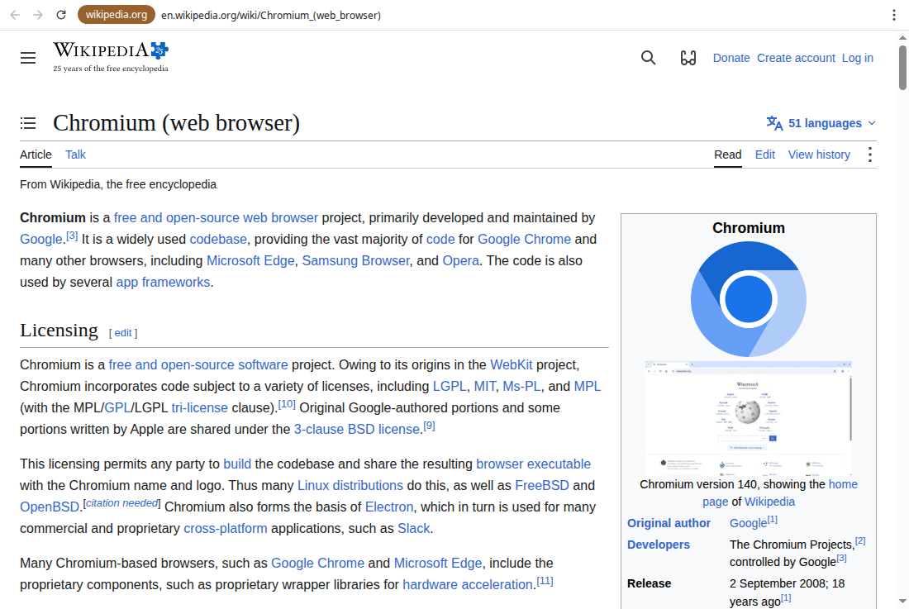

# low-ram-browser (lrb)

A Chromium-based browser with the smallest memory footprint that still
browses the mainstream web, for machines where every kilobyte counts:
2 GB laptops, a 1 GB Raspberry Pi, or any computer whose RAM other programs
already hold.



It is built on Chromium's `//content` layer, not the Chrome product, and
follows Chromium's Stable releases. Every change is judged by measured
memory, and keeping mainstream sites working is the hard constraint.

**Status: experimental.** It is usable day to day.

lrb has two modes and picks one each time it starts
([docs/design.md](docs/design.md#modes)):

- **Lean**, for machines where memory is tight (a 2 GB laptop, a 1 GB
  Raspberry Pi, a kiosk): one single-process instance per site, each with
  its own profile, confined as a whole (Landlock, seccomp) in place of
  Chromium's per-renderer sandbox. Sites never share a process or a cookie
  jar; signing in to Google serves one site at a time.
- **Standard**, when there is memory to spare (3 GB of RAM or more, 1.5 GB
  free at start, and a working sandbox): Chromium's usual processes,
  sandboxed renderers with site isolation, one browser and one profile for
  every site, so signing in once serves every site, as in Chrome. Still
  without the Chrome layer, with the same bar, content blocking and
  defaults.

Settings can force either. The security target is today's standard
(Chrome's): never lower, and in lean mode higher in some places and lower
in others; see [Security](#security).

## How it saves memory

- **Lean mode: one site per window, one process per window.** Each site
  gets its own single-process browser instance and its own profile, so
  sites never share a process or a cookie jar. Tabs exist within a site's
  window. Leaving a site swaps the window for the other site's and parks
  the one left (hidden, alive, first to go under pressure): Back brings it
  straight back. ([docs/design.md](docs/design.md))
- **Pressure-driven.** Background tabs and windows sleep under memory
  pressure (below 30% or 512 MB available, whichever is less), keeping
  their history and sparing pages with unsaved changes, and the oldest
  close only as a last resort. A small coordinator process that never
  loads web content decides.
- **Content blocking** with Brave's adblock-rust (uBlock Origin-compatible
  lists), built once and shared read-only by every instance.
- **No autoplay**, muted or not, before the user interacts with the page.
- **Lean defaults:** software compositing (the GPU is an option),
  no prerendering, and Stable's feature defaults without Chromium's
  experiment test config; in lean mode also low-end-device mode, V8
  optimizing for size and no back-forward cache.
- **A native slim bar** (Views, about 2 MB per window) rather than an HTML
  one.

## Security

- **Sites are kept apart by processes and profiles:** a site never shares
  a process or its cookies and storage with another site.
- **In standard mode** the protection is Chromium's own: each site's
  renderers in their own sandboxed processes, the browser process trusted,
  as in Chrome. What follows is lean mode, where the whole instance is one
  process.
- **Every site's process is confined** by `lrb_coordinator` before it
  starts: Landlock limits it to its own profile, the browser's files, and
  what a desktop browser needs (system libraries, fonts, themes, sound,
  camera, GPU, and your certificate store `~/.pki/nssdb` to read but not
  change), not your home directory or other sites' profiles. seccomp
  refuses system calls a browser never needs, and `no_new_privs` keeps
  setuid programs from giving privileges back. On a kernel without
  Landlock, seccomp and `no_new_privs` still apply.
- **Your files only through the file picker:** uploads and downloads go
  through the desktop's own file dialog (XDG portal), shown by the
  coordinator, which hands the site only the file you chose. Upload copies
  are deleted when the site's process exits.
- **Third-party content inside a page** (ads, embeds) shares that page's
  process, unlike in Chrome; content blocking removes most of it.
- **Bookmarks and the sites you've visited** are kept by the coordinator
  and given to any site's window that asks (for the address bar's
  suggestions and the bookmarks menu): a compromised site could read that
  list, though not other sites' pages, cookies or data.
- **Saved passwords and autofill** live in your desktop's keyring (GNOME
  Keyring, KWallet), not in a site's process. A site's window can ask for
  its own site's passwords only. Your name, address, email and phone are
  shared by every site, so a compromised site could read them without
  asking; passwords of other sites stay out of its reach.
- **Links for other apps** (`mailto:`, `tel:`, meeting links) open only
  after you say yes in the window, but that question is asked in the
  site's own process: a compromised site could open such links without
  asking. The coordinator still refuses anything but links for apps
  (never web pages or files) and allows one every 2 seconds.

Details and the comparison with Chrome: [docs/design.md](docs/design.md#security-model).

## Against Chromium

lrb 0.1.0-alpha.4 against the Chromium snap of the same release
(155.0.8059.39), both as installed: started from their own launchers with
a window on the desktop, a fresh profile, no memory limit. lrb with GPU
rendering and content blocking on; Chromium with `--no-first-run`, so it
opens no welcome tab. Every process each browser runs, 60 s after opening
one page, medians of 3 runs, MB (Intel i7-8700, 15 GB, Ubuntu GNOME):

| page | Chromium | lrb | saved |
|---|---:|---:|---:|
| Wikipedia | 497 | 259 | 48% |
| GitHub | 541 | 315 | 42% |
| BBC News | 710 | 285 | 60% |
| Reddit | 509 | 324 | 36% |

Total PSS, including the program's own code. Counting only memory that
can't be paged out, Chromium held 231-427 MB and lrb 74-121 MB. Chromium
ran 10 processes per page (24 on BBC News); lrb ran 2, its coordinator
(1 MB) and the site.

## On a Raspberry Pi 3 (1 GB)

A Raspberry Pi 3 Model B+ (905 MB usable, 905 MB zram, Debian 13 64-bit)
running the arm64 alpha. Memory that can't be
paged out (anonymous + shared), MB, one site at a time without content
blocking:

| page | software rendering | GPU |
|---|---:|---:|
| blank | 32 | 39 |
| Wikipedia | 86 | 93 |
| GitHub | 105 | 125 |
| Reddit | 123 | 134 |
| BBC News | 155 | 161 |
| YouTube | 254 | 309 |

Five sites opened one after another through `lrb_coordinator`, content
blocking on:

| sites open | lrb | free memory |
|---|---:|---:|
| 1 | 87 MB | 546 MB |
| 2 | 169 MB | 422 MB |
| 3 | 285 MB | 302 MB |
| 4 | 277 MB | 311 MB |
| 5 | 325 MB | 242 MB |

Memory pressure began at the third site; the coordinator put the least
recently used windows to sleep, so five open sites cost about what three
did. Every site loaded, nothing crashed, and the kernel killed nothing.
Not measured yet: load times and how smooth scrolling and video are with
and without the GPU.

## Safety and privacy defaults

- No permission without the user saying yes. Camera, microphone and
  clipboard reading are asked about in the window and remembered per site.
  Everything else is refused.
- Pages and downloads on public lists of phishing sites and malware
  (malware-filter's, from OpenPhish, PhishTank and URLhaus, and uBlock
  Origin's badware list) are stopped before anything is fetched from them,
  with Back and Continue anyway. The lists are checked on your machine, so
  no address you visit is sent anywhere, and refreshed each time lrb starts
  (if over an hour old), never while it runs. They catch less than Google
  Safe Browsing, which lrb doesn't use. About 0.85 MB per site window.
- Downloads always ask where to save.
- No remote-debugging server unless explicitly asked for.
- Origin trials use Chromium's production key.

## Everyday use

- **Picks up where you left off.** Started from the applications menu, lrb
  opens the sites you had open, the one you used last in front (Settings:
  or an empty window, or a page of your choice). Windows are saved as you
  browse, so after a crash, a power cut or a logout they come back with
  their history. Closing a site's windows yourself forgets them. Logins
  persist too: session cookies are kept and restored, as Chrome does when
  it continues where you left off. What's saved stays in the profile on
  disk: pages' addresses, titles, form contents and cookies.
- **Another site, beside this one:** Shift+Enter (or Alt+Enter) in the
  address opens what you typed in a new window and keeps this one. Typing
  another site's address in a window with several tabs keeps the tab and
  opens the site beside it.
- **History.** Typing in the address also offers pages you visited (kept
  in the site's profile in lean mode, in the one profile in standard
  mode); the menu lists the most recent. "Forget this site's data" in the
  menu removes its cookies, storage, cache, permissions and zoom.
- **A newer release** shows as "Update available" in the bar (checked once
  a day against the releases page; a click opens it). Installing is still
  by hand.
- **Bookmarks and suggestions.** The star in the bar (or Ctrl+D)
  bookmarks the page; the menu lists your bookmarks. Typing in the address
  offers bookmarks and sites you've visited, and completes an address as
  you type (Enter takes it, typing on replaces it). These lists span
  sites, so the coordinator keeps them, not a site's process: any site's
  window can ask for them, so a compromised site could learn which sites
  you visit and bookmarked (not what you did there). A site can only add or
  remove bookmarks of its own pages.
- **Links for other apps:** `mailto:`, `tel:`, Zoom and Teams meeting
  links and the like open in your desktop's app for them, after you say
  yes in the window.
- **Saved passwords:** after you sign in, the window offers to save the
  password in your desktop's keyring; on the sign-in form next time, it
  offers to fill it in. Nothing is filled in without your yes. Without a
  keyring (some minimal desktops), it isn't offered.
- **Autofill:** your name, address, email and phone, remembered after you
  fill in a form (if you agree) and offered on forms of every site.
- **Certificate errors** are explained in the window (expired, for
  another site, an untrusted authority, a wrong clock) with Back, and
  Continue anyway unless the site requires valid HTTPS. On a Wi-Fi network
  that wants you to sign in first (hotels, airports), it offers that
  instead.
- **Print to PDF** (Ctrl+P, the menu, or the page's own Print button): the
  page as a PDF saved where you choose; print it from your PDF viewer.
  There's no print dialog or preview: Chrome's costs tens of MB.
- **Dark pages**, per site, from the menu: pages that have a dark theme
  use it, Blink darkens the rest.
- **Page icons** in the tabs and on the window (taskbar, Alt+Tab).
- **The site's memory in the title bar** (Settings, off by default), after
  the page's title (e.g. `Linux - Wikipedia — 259 MB`): the site's whole
  process, re-read every 5 s.
- **Shortcuts:**

  | Keys | Does |
  |---|---|
  | Ctrl+T, Ctrl+N | New tab, new window (of the same site) |
  | Ctrl+W, middle-click on a tab | Close the tab |
  | Ctrl+Shift+T | Reopen the last closed tab, with its history |
  | Ctrl+Tab, Ctrl+1...9 | Switch tabs |
  | Ctrl+L, Alt+D | Edit the address |
  | Shift+Enter, Alt+Enter (in the address) | Open in a new window |
  | F6, Shift+F6 | Move between the page, the address and a question |
  | Alt+Left, Alt+Right, Alt+Home | Back, forward, the site's home page |
  | F5, Ctrl+R, Esc | Reload, stop loading |
  | Ctrl+F, Ctrl+Plus/Minus/0 | Find, zoom (remembered per site) |
  | Ctrl+D, Ctrl+P | Bookmark the page (again: remove it), print to PDF |
  | F11, Alt+F | Full screen, the menu |

- **Settings** (in the menu): search engine, GPU or software rendering,
  the mode (automatic, lean or standard; applies at the next start), what
  to open on start, how much content blocking (full lists, lighter ones
  for less memory, or off; the menu also turns it off for one site),
  whether downloads ask where to save, and memory in window titles.
- **About lrb** (in the menu): the version and the source it was built
  from, the Chromium version under it and the day Chromium released it
  (to compare with Chromium's latest release), a link to this repository,
  and the licenses of every component.

## What it leaves out

On purpose, for memory or safety:

- **Extensions and sync.** Content blocking is built in.
- **DRM** (Widevine): Netflix, Spotify and other protected video and
  music won't play.
- **The PDF viewer:** PDFs download; open them in your PDF viewer.
- **Notifications and location:** refused for every site.
- **Screen sharing:** refused, so video calls in the browser can't
  present your screen (camera and microphone work, after asking).
- **Translation:** it would send pages' text to an online service.
- **Automatic updates:** new releases, with Chromium's security fixes,
  are installed by hand (see [Download](#download)); the bar says when
  one exists.

## Download

Pre-releases for 64-bit x86 and ARM Linux (a Raspberry Pi with the 64-bit
OS) are on the [releases page](https://github.com/carlosbravoa/low-ram-browser/releases).

```sh
tar --zstd -xf low-ram-browser-<version>-linux-x64.tar.zst
cd low-ram-browser-<version>
./low-ram-browser            # try it from here
./install.sh                 # optional: applications menu and PATH, no root
```

## Building and running

Linux x86-64 build machine, about 100 GB of disk and 32 GB of RAM. Builds
x64 and arm64. See [docs/building.md](docs/building.md).

```sh
build/setup_checkout.sh      # depot_tools + Chromium at CHROMIUM_COMMIT
build/apply_patches.sh       # patches/ onto the checkout
build/build.sh x64           # -> dist/lrb-x64-<commit>.tar.zst
tar --zstd -xf dist/lrb-x64-*.tar.zst
content-shell/lrb_coordinator https://en.wikipedia.org
```

## Layout

| Path | What |
|---|---|
| `lrb/` | The browser: a `//content` embedder (`//lrb` in the Chromium checkout), its coordinator and content blocking. |
| `patches/` | The only changes to Chromium itself, as `git am` patches against `CHROMIUM_COMMIT`. |
| `build/` | Checkout, patch, build, package a release. |
| `CHROMIUM_COMMIT`, `CHROMIUM_RELEASE` | The Chromium Stable release lrb builds on: its commit, version and release day. |
| `VERSION` | lrb's version, shown in About. |
| `docs/` | Design and security model, building. |

## License

BSD-3-Clause ([LICENSE](LICENSE)). Third-party code and licenses:
[THIRD_PARTY.md](THIRD_PARTY.md).
